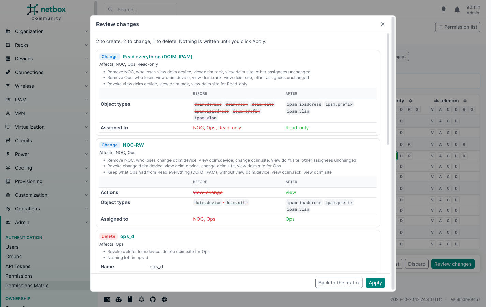

# Export and import

The matrix can be saved as a YAML file and loaded back, on the same NetBox or another one. Use it to keep a copy of
who can do what, to review access in a pull request, or to copy a set of grants from a test instance to production.

An import never writes anything by itself. It stages cell changes in the matrix, exactly as if you had clicked the
cells, and opens the review. Nothing changes until you click Apply.

## Exporting

Click **Export** in the matrix toolbar. The file covers what the page shows:

- the columns: the groups and users picked with **Groups** and **Users**;
- the rows: the app filter and the search box narrow the object types, as they do on the page;
- every action, whichever tab is open.

The **Only rows with grants** switch does not narrow the export. Rows without grants still belong in the file:
importing it should revoke anything granted there later.

The same file is available at `/plugins/permissions-matrix/export/`, with the page's query parameters: `group_id` and
`user_id` (repeatable), `groups=0` (no groups), `users=1` (every user with direct permissions), `app` and `q`. Exporting needs the same rights as viewing the matrix (see
[Permissions](permissions.md)).

## The file

```yaml
version: 1
scope:
  principals:
  - type: group
    name: NOC
  - type: user
    name: alice
  actions:
  - view
  - change
  object_types:
  - dcim.device
  - dcim.site
  - ipam.prefix
grants:
  group:NOC:
    view:
    - dcim.device
    - dcim.site
    change:
    - dcim.device
  user:alice:
    view:
    - ipam.prefix
constrained:
  group:NOC:
    change:
    - object_type: ipam.prefix
      permission: Paris prefixes
      constraints:
        site__slug: paris
disabled: {}
```

- `scope` records what was shown when the file was exported: the principals, the actions and the object types.
- `grants` lists, per principal and action, the object types granted without constraints.
- `constrained` lists the grants that carry constraints, with the permission's name and its constraints, for
  reference.
- `disabled` lists cells covered only by disabled permissions.

Groups are named by their name, users by their username and object types by `app_label.model`. IDs are never used,
so the file means the same thing on any NetBox that has the same groups and users.

## Importing

Click **Import** and pick a file. You need the right to add, change or delete permissions.

Inside the file's scope, the file is the full desired state:

- a cell listed under `grants` is granted;
- a cell in the scope but not listed anywhere is revoked;
- anything outside the scope is left alone. A file exported with the app filter on DCIM never touches IPAM, and a
  file with only the NOC column never touches Ops.

The changes are planned with the same [rules](changes.md) as clicks in the matrix: new grants go into simple
permissions, and revoking from a shared permission splits it so nobody else loses access.

### Constrained and disabled entries

The import never creates or changes constraints. A cell listed under `constrained` or `disabled` keeps whatever grants
it on the target today. The review warns in two cases:

- nothing grants the cell on the target: it stays not granted;
- the target grants the cell without constraints: it stays granted, so the target gives more access than the file.
  Revoke it in the matrix and add the constraints to the permission by hand if that is not what you want.

To copy constrained access, create the constrained permission on the target first (or let the file's `constraints`
guide you), then import.

### Errors

The review lists, without staging anything for them:

- groups and users the file names that do not exist on the target, or that you are not allowed to see;
- object types that do not exist on the target, for example because a plugin is not installed.

The import never creates groups or users. A file that is not valid YAML, or not a matrix export, is refused with a
message. YAML anchors and aliases are refused too: an export never contains them.



## From the API

`POST /api/plugins/permissions-matrix/import/` takes the file's text and returns the cell changes, which you can send
to `plan/` and `apply/`. See the [REST API](api.md#post-import).
