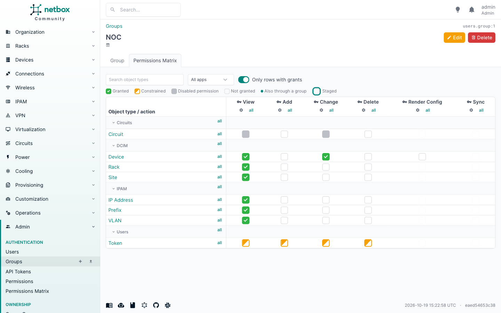

# Group tab

Every group's page in NetBox (**Admin > Authentication > Groups**, then a group) gets a **Permissions Matrix** tab. It
shows that one group's matrix turned around:

- object types down the side, grouped by app, as on the main page;
- one column per action: View, Add, Change, Delete, then custom and other actions;
- the same [cell states](matrix.md#cell-states), tooltips, search, app filter and **Only rows with grants** switch.

Use it to answer "what can this group do?" in one screen, or to review a group before adding someone to it.

## Changing cells

With the right to change permissions, cells toggle and stage exactly as on the main page, and **Review changes** shows
the same plan. Rows and actions have **all** toggles. Custom actions are only enabled on the rows of models that
register them.

The gear next to each action opens the [gear panel](matrix.md#the-gear-panel) for this group and that action.

## Who sees the tab

The tab appears for users with `users.view_objectpermission`. Like the main page, it then needs that view to be
unconstrained: see [Permissions](permissions.md).

Export and import are on the main page only. To export one group, pick only its column with **Columns** there, then
click **Export**.
