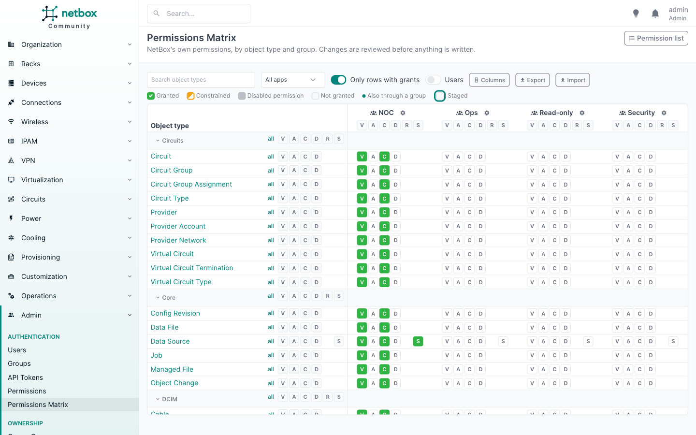
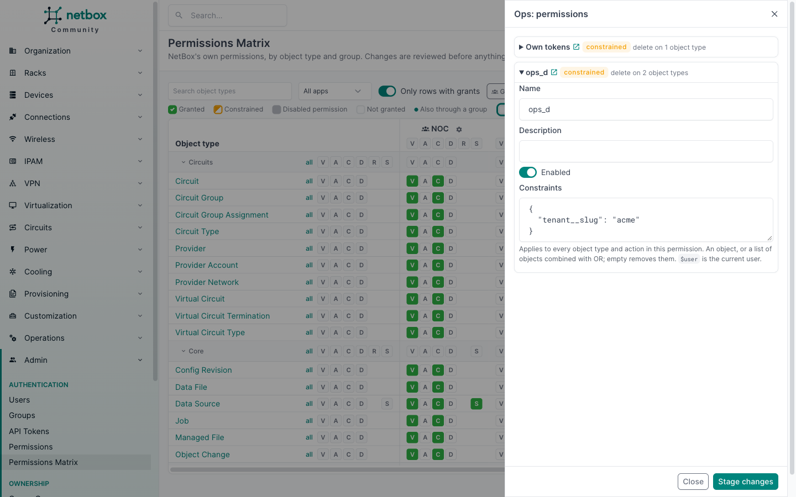

# The matrix

Open **Admin > Authentication > Permissions Matrix**.



```
[search] [apps] [ ] Only rows with grants  [Groups] [Users]  [Export]  [Import]

                            |   NOC ⚙       |   Ops ⚙       |
                            | [V A C D R S] | [V A C D R S] |
  DCIM      all V A C D R S |               |               |
    Device  all V A C D R   |  V A C D R    |  V A C D R    |
    Site    all V A C D     |  V A C D      |  V A C D      |
  Core      all V A C D R S |               |               |
    Data S. all V A C D   S |  V A C D   S  |  V A C D   S  |

                                            3 changes staged   [Discard] [Review changes]
```

## Actions

**All actions** opens first: each cell holds one lettered chip per action, so everything a group or user can do
on an object type is on one line.

| Letter | Action |
|--------|--------|
| V | View |
| A | Add |
| C | Change |
| D | Delete |
| R | Render Config |
| S | Sync |

Custom actions registered by models, such as Sync on data sources or Render Config on devices, only have a chip on
the rows whose model has them; the slot stays empty elsewhere so the letters line up down the column. Other actions
found in existing permissions (typed into "Additional actions" on the classic form) get a chip on every row, with
their first letter: NetBox cannot tell which models they apply to.

With the `show_action_tabs` [setting](configuration.md) on, tabs next to All actions show one action at a time, with
one box per cell. The active tab is kept in the URL (`?action=change`), so a tab can be bookmarked; All actions is
`?action=*` or no parameter. The setting is off by default, and the page then shows only the all-actions grid.

## Rows and columns

Rows are the object types NetBox lets you put in a permission, grouped by app. Click an app name to collapse it.

- **Search** filters rows by model or app name.
- **Apps** limits the apps shown.
- **Only rows with grants** hides rows where no visible column has the action.

Columns are groups, then users, each by name. **Groups** picks which groups are shown: all of them at first.
**Users** picks which users are shown, among those who have a permission assigned directly: none at first. Users who
get access only through a group have no column; the [who can](who-can.md) page shows them. When not every group, or
any user, is shown, the button counts them (`3/42`). The choice is kept in the URL, so it can be bookmarked.

The header row and the object type column stay in place while you scroll.

Click an object type to open its [who can](who-can.md) page.

## Cell states

Each chip, or box on a single-action tab, shows one of these states:

| Look | State | Meaning |
|------|-------|---------|
| empty | Not granted | No permission covers the cell. |
| filled green | Granted | At least one enabled permission without constraints covers the cell. |
| half filled | Constrained | Only permissions with [constraints](constraints.md) cover the cell: access to some objects, not all. |
| ticked, dimmed | Disabled | Only disabled permissions cover the cell. NetBox ignores them. |
| coloured outline | Staged | Changed on the page, not applied yet. |

Hover a chip or box to see every permission that covers it, with its constraints.

In a user column, a small dot marks access the user also has through a group; the tooltip names the group. The dot
is only information: the user column changes the user's own permissions, never the group's.

## Changing cells

Click a chip (or a box on a single-action tab) to toggle it between granted and not granted. A constrained or
disabled one becomes granted on the first click; the second click revokes it completely.

In the all-actions grid, each column header has a row of letters: click one to toggle that action for the whole
column. Each row and app section reads **all V A C D ...**: **all** toggles every action in every visible column,
and a letter toggles only that action, for example **D** on the Device row gives or takes delete on Device for
every group shown. On a single-action tab, column headers, rows and app sections have an **all** toggle for that
action. Each toggle ticks every visible, enabled
cell in its line, or unticks them all if they are already ticked.

Changes are only staged in your browser. The bar at the bottom counts them; **Discard** forgets them. Leaving the
page with staged changes asks for confirmation.

## Review and apply

**Review changes** asks NetBox to plan the staged changes, without writing anything, and shows every permission it
would create, change or delete, field by field, with the groups and users each change affects and any warnings.
[How changes map to permissions](changes.md) explains the rules.

**Apply** writes the plan in one transaction. If someone changed one of the permissions involved since the review,
nothing is written and the page asks you to reload.

## The gear panel

The gear next to a column name opens a panel listing the group's or user's permissions: all of them in the
all-actions grid, the ones granting the action on a single-action tab. Each shows its actions and how many object types
it covers, and links to its page in NetBox. Open one to edit:

- name and description;
- enabled;
- constraints, for every object type and action in that permission.



Panel changes are staged and reviewed like cell changes. A permission shared with other groups or users says so at
the top of its form: editing it changes their access too. If a new name is already taken, the review shows it with
a number appended.

Panel edits are applied before the cell changes of the same review. So if you disable `noc_v` and tick view on
another object type in one go, the new grant goes into a new permission and is not disabled with `noc_v`. If the
cell changes remove everything from a permission you also edited, the permission is deleted and the review warns
that the edit is lost.

Adding constraints to a simple permission such as `ops_va`, or disabling it, makes it no longer simple: the review warns that new
grants of view and add for Ops will then go into a new permission (`ops_va 2`). To give a group constrained access
to some object types and full access to others, keep them in separate permissions. To add actions, groups or users
to a permission, use its page in NetBox or the [REST API](api.md).

Constraints use NetBox's format: an object, or a list of objects combined with OR, and `$user` for the current user.
[Constraints](constraints.md) explains them in full, with recipes.
They are checked against every object type of the permission, as on the classic form.

## Read-only mode

Users who may view permissions but not add, change or delete them see the matrix read-only: chips show their state but do not toggle, and there is no review. See
[Permissions](permissions.md).
