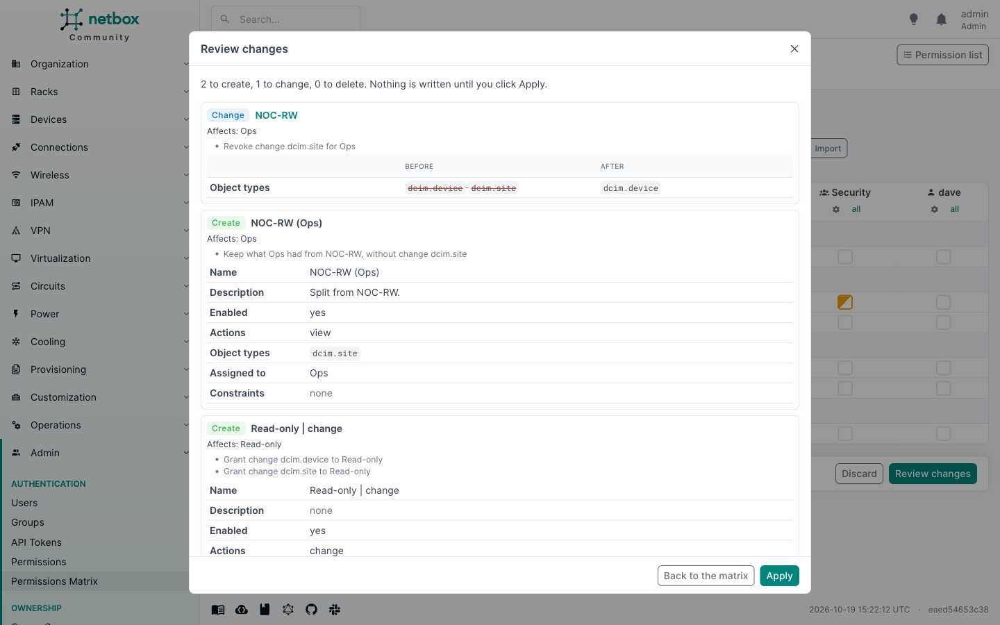

# Quick start

Ten minutes from install to a first reviewed change. This assumes the plugin is [installed](installation.md) and you
are logged in as a superuser.

## 1. Open the matrix

Go to **Admin > Authentication > Permissions Matrix**. The **View** tab is open: one row per object type, one column
per group, and a ticked box wherever a group may view that object type.

If there are no groups yet, create one first (**Admin > Authentication > Groups**). The matrix never creates groups
or users.

## 2. Read it

- A ticked box means granted. A half-filled box means granted under constraints, for some objects only. A dimmed tick
  means only a disabled permission covers it. See [cell states](matrix.md#cell-states).
- Hover a cell to see which permissions cover it.
- Type in the search box, or pick an app, to narrow the rows. Switch on **Users** to add columns for users who have
  permissions of their own.
- Click an object type name to see [who can](who-can.md) do anything with it, across every action.

## 3. Change something

1. Switch to the **Change** tab.
2. Tick **Device** in the column of a group, say NOC. The box gets a coloured outline: the change is staged, not
   written.
3. Untick a box that is already ticked, in another column.
4. Click **Review changes** in the bar at the bottom.

The review lists every permission NetBox would create, change or delete, field by field, and which groups and users
each one affects. Ticking usually creates or grows a permission named like `NOC | change`. Unticking a cell that a
permission shares with other groups splits that permission, so the other groups keep exactly what they had.
[How changes map to permissions](changes.md) explains every rule.

5. Click **Apply**. Everything is written in one transaction, and the matrix reloads.

The new or changed permissions are ordinary NetBox permissions: open **Admin > Authentication > Permissions** to see
them, with their change log entries.

## 4. Look at one group

Open a group (**Admin > Authentication > Groups**, then a group) and its **Permissions Matrix** tab: the same cells,
turned around, with every action as a column. See [Group tab](group-tab.md).

## 5. Keep a copy

Click **Export** to download the shown part of the matrix as YAML, for every action. Importing it later, here or on
another NetBox, stages whatever differs, for review. See [Export and import](export-import.md).

## Next

- [Permissions](permissions.md): who may use the matrix, and who may change it.
- [Configuration](configuration.md): the name of new permissions, menu placement, hidden apps.
- [Limitations](limitations.md): what the matrix does not show.
