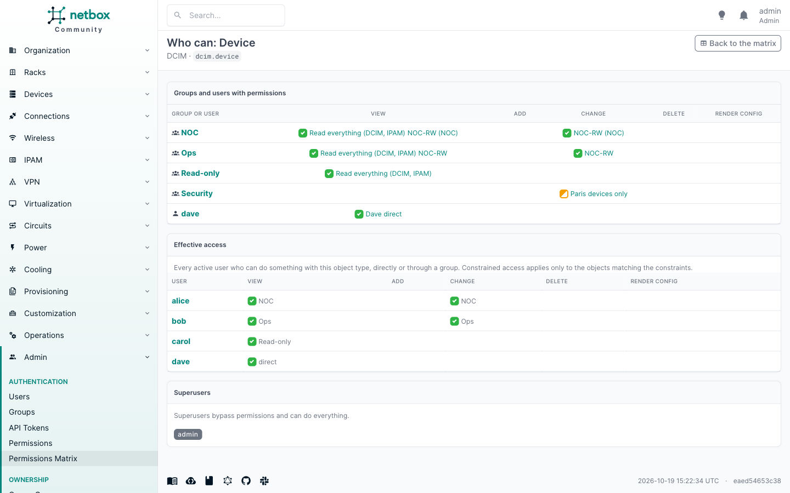

# Who can

The matrix answers "what can this group do?". The who-can page answers the other question: "who can do what to this
object type?".

Open it by clicking an object type in the matrix, or at
`/plugins/permissions-matrix/object-types/<app_label>.<model>/`, for example
`/plugins/permissions-matrix/object-types/ipam.prefix/`.

## Principals

The first table has a row for every group and user that holds any action on the object type through a permission
assigned to it, and a column per action. Cells use the same [states](matrix.md#cell-states) as the matrix, and hovering
one lists the permissions behind it.

## Effective access

The second table resolves group membership: one row per user who can do anything with the object type, with each
action and where it comes from (a direct permission, or the groups that grant it). Constrained access is shown with
its constraints, because whether it applies depends on the object.

Superusers are listed separately: they bypass permissions and can do everything.

Inactive users are left out, because NetBox refuses them whatever their permissions.
